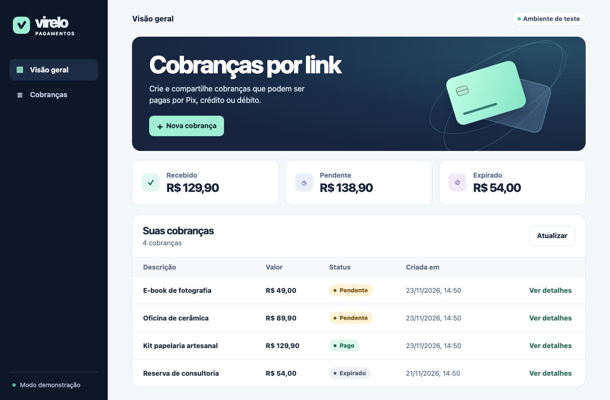

# Virelo Pagamentos

Uma demo de link de pagamento feita com Java e Spring Boot. O lojista cria a cobrança, compartilha o link e acompanha as tentativas. Quem abre o checkout pode simular pagamentos com Pix, crédito ou débito.

[**Testar a demo online**](https://virelo-payments.onrender.com/)

[](https://render.com/deploy?repo=https://github.com/DandaraEmiliano/virelo-payments)



## Experimente

Com **Java 21** e **Maven** disponíveis, rode na raiz do projeto.

```bash
mvn spring-boot:run
```

Abra [http://localhost:8080](http://localhost:8080). O banco H2 local é criado em `data/` e a primeira execução inclui cobranças de exemplo. Use `VIRELO_SEED=false` para começar com um banco novo vazio.

Para gerar o JAR, use `mvn package` e rode `java -jar target/virelo-payments-0.1.0.jar`.

1. Crie uma cobrança de R$ 89,90 e abra o checkout pelo painel.
2. Selecione **Cartão de débito** e **Simular recusa**.
3. Selecione **Pix**, gere a tentativa e simule a confirmação.
4. Volte ao painel e abra os detalhes. O total recebido inclui o Pix e o histórico mostra a tentativa de débito recusada.

O crédito e o débito têm cenários de aprovação e recusa selecionáveis. O Pix tem duas etapas, geração e confirmação. Todos usam dados de demonstração e dispensam dados de cartão ou credenciais de um provedor.

## Demo no Render

O Blueprint cria um serviço web gratuito com Docker. A demo pública usa um painel compartilhado e inicia com cobranças de exemplo a cada reinício. Use descrições fictícias, visíveis aos visitantes.

## Como funciona

O Spring Boot serve as telas em HTML, CSS e JavaScript e a API usada pelo painel e pelo checkout. A API mantém cobranças e tentativas em tabelas relacionais, com valores em centavos. Cada link expira após 24 horas.

Uma transação com bloqueio da linha da cobrança serializa as confirmações concorrentes. A mesma chave de tentativa pode ser reenviada com os mesmos dados, e a confirmação de um Pix já aprovado devolve a tentativa existente. Quando uma tentativa é aprovada, outras tentativas Pix pendentes da mesma cobrança são encerradas.

O Actuator expõe `/actuator/health`. Consulte `/actuator/metrics/virelo.payment.transitions` após uma tentativa para ver os contadores por método e status. Os logs registram os identificadores da cobrança e da tentativa após a confirmação no banco.

## PostgreSQL

```bash
docker compose up -d postgres
VIRELO_DB_URL=jdbc:postgresql://localhost:5432/virelo \
VIRELO_DB_USER=virelo VIRELO_DB_PASSWORD=virelo mvn spring-boot:run
```

As credenciais do Compose são de demonstração. O painel e o checkout compartilham um ambiente local, que escuta em loopback por padrão.

## Testes

```bash
mvn test
```

A suíte cobre pagamentos concorrentes, repetição de tentativas, transição de débito recusado para Pix aprovado, expiração e validação de valores. Para executar a mesma suíte com PostgreSQL, informe as variáveis abaixo usando um banco de teste.

```bash
docker compose exec -T postgres createdb -U virelo virelo_test
VIRELO_TEST_DB_URL=jdbc:postgresql://localhost:5432/virelo_test \
VIRELO_TEST_DB_USER=virelo VIRELO_TEST_DB_PASSWORD=virelo mvn test
```
